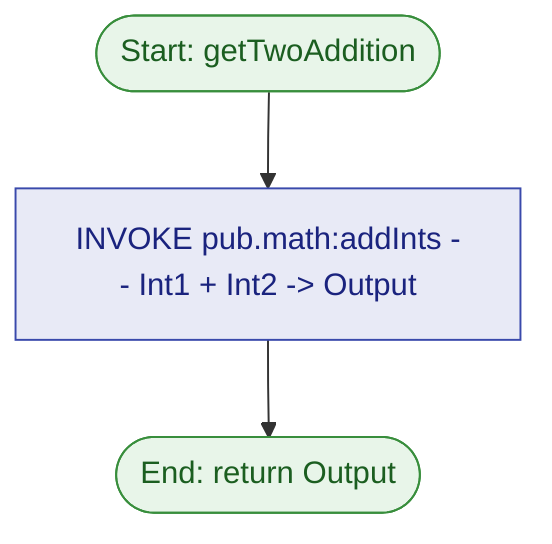

# Service Documentation: demo.isl:getTwoAddition

## Purpose
Computes the sum of two integers passed as input parameters and returns the total result. The addition is performed in a single step by invoking `pub.math:addInts` with the two operands.

## Service Signature

### Inputs
| Parameter | Type | Constraints | Description |
|---|---|---|---|
| `Int1` | `String` | — | The first integer operand, represented as a String, to be added. |
| `Int2` | `String` | — | The second integer operand, represented as a String, to be added. |

### Outputs
| Parameter | Type | Description |
|---|---|---|
| `Output` | `String` | The sum of `Int1` and `Int2`, returned as a String. |

## Flow Diagram

## Usage Examples

### Example 1 — Addition de deux entiers positifs
**Input:**
| Parameter | Value |
|---|---|
| `Int1` | `"15"` |
| `Int2` | `"27"` |

**Output:**
| Parameter | Value |
|---|---|
| `Output` | `"42"` |

### Example 2 — Addition avec un entier négatif
**Input:**
| Parameter | Value |
|---|---|
| `Int1` | `"100"` |
| `Int2` | `"-38"` |

**Output:**
| Parameter | Value |
|---|---|
| `Output` | `"62"` |

## Implementation Details

Le service effectue un unique appel à `pub.math:addInts` :

1. `Int1` est mappé vers le paramètre d'entrée `num1` de `pub.math:addInts`.
2. `Int2` est mappé vers le paramètre d'entrée `num2` de `pub.math:addInts`.
3. Le résultat `value` retourné par `pub.math:addInts` est capturé et mappé vers la variable de sortie `Output`.

Tous les paramètres sont de type `String`, conformément au contrat d'entrée/sortie de `pub.math:addInts`.

## Error Handling

Aucun bloc TRY/CATCH n'est présent dans ce service. Si l'une des valeurs passées en entrée n'est pas un entier valide représenté sous forme de String, `pub.math:addInts` lèvera une exception de service qui sera propagée directement à l'appelant.

## Related Services

| Service | Purpose |
|---|---|
| `pub.math:addInts` | Additionne deux entiers représentés sous forme de String et retourne leur somme (`value`). |

## Notes

- Les paramètres d'entrée et la sortie sont de type `String`, conformément à la convention de pipeline webMethods et au contrat de `pub.math:addInts`.
- La valeur maximale supportée est limitée par la largeur du type `long` Java (64 bits). Un débordement arithmétique se produira si la somme dépasse cette limite.
- Les valeurs doivent être passées dans un format neutre (sans séparateurs de milliers ni virgules localisées), par exemple `"1234"` et non `"1,234"`.
