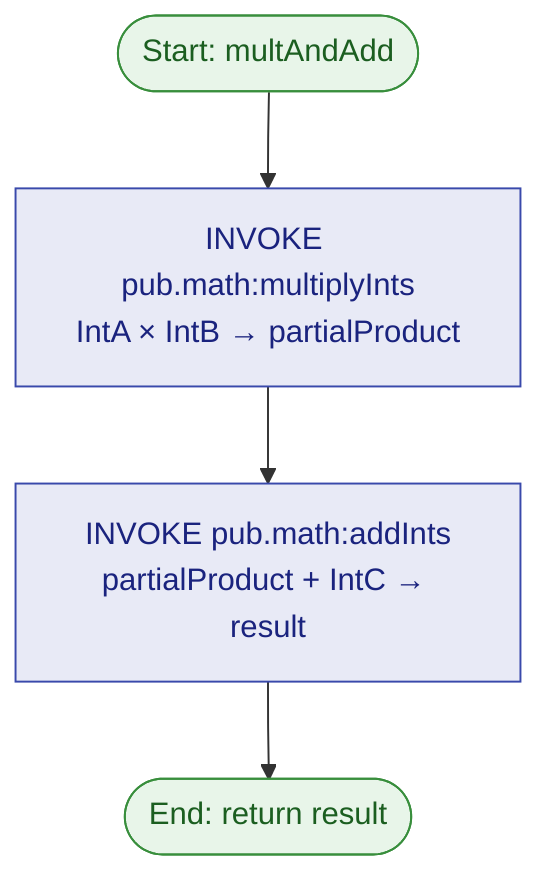

# Service Documentation: demo.isl:multAndAdd

## Purpose
Computes the expression `(IntA × IntB) + IntC` and returns the result. The service first multiplies the two first operands to produce an intermediate product, then adds the third operand to that product to yield the final result.

## Service Signature

### Inputs
| Parameter | Type | Constraints | Description |
|---|---|---|---|
| `IntA` | `String` | — | The first integer operand (multiplicand), represented as a String. |
| `IntB` | `String` | — | The second integer operand (multiplier), represented as a String. |
| `IntC` | `String` | — | The third integer operand (addend), represented as a String, added to the product of IntA and IntB. |

### Outputs
| Parameter | Type | Description |
|---|---|---|
| `result` | `String` | The result of `(IntA × IntB) + IntC`, returned as a String. |

## Flow Diagram

## Usage Examples

### Example 1 — Cas nominal : (3 × 4) + 5 = 17
**Input:**
| Parameter | Value |
|---|---|
| `IntA` | `"3"` |
| `IntB` | `"4"` |
| `IntC` | `"5"` |

**Output:**
| Parameter | Value |
|---|---|
| `result` | `"17"` |

### Example 2 — Multiplicande négatif : (-2 × 6) + 10 = -2
**Input:**
| Parameter | Value |
|---|---|
| `IntA` | `"-2"` |
| `IntB` | `"6"` |
| `IntC` | `"10"` |

**Output:**
| Parameter | Value |
|---|---|
| `result` | `"-2"` |

### Example 3 — Multiplication par zéro : (0 × 99) + 7 = 7
**Input:**
| Parameter | Value |
|---|---|
| `IntA` | `"0"` |
| `IntB` | `"99"` |
| `IntC` | `"7"` |

**Output:**
| Parameter | Value |
|---|---|
| `result` | `"7"` |

## Implementation Details

Le service enchaîne deux appels séquentiels aux services de la bibliothèque `pub.math` :

1. **Multiplication** : `IntA` et `IntB` sont passés à `pub.math:multiplyInts`. Le résultat (`value`) est capturé dans la variable intermédiaire de pipeline `partialProduct`.
2. **Addition** : `partialProduct` et `IntC` sont passés à `pub.math:addInts`. Le résultat final (`value`) est mappé vers la variable de sortie `result`.

Conformément à la règle BP-002 (stale variable leakage), le second INVOKE redéclare explicitement `num1` et `num2` dans son bloc de mapping d'entrée afin d'écraser les valeurs résiduelles laissées dans le pipeline par le premier appel.

## Error Handling

Aucun bloc TRY/CATCH n'est présent dans ce service. Si l'une des valeurs passées en entrée n'est pas un entier valide représenté sous forme de String, le service `pub.math` appelé lèvera une exception qui sera propagée directement à l'appelant.

## Related Services

| Service | Purpose |
|---|---|
| `pub.math:multiplyInts` | Multiplie deux entiers représentés sous forme de String et retourne leur produit (`value`). Utilisé à l'étape 1. |
| `pub.math:addInts` | Additionne deux entiers représentés sous forme de String et retourne leur somme (`value`). Utilisé à l'étape 2. |

## Notes

- Tous les paramètres d'entrée et la sortie sont de type `String`, conformément à la convention de pipeline webMethods et au contrat des services `pub.math`.
- La valeur maximale supportée est limitée par la largeur du type `long` Java (64 bits). Un débordement arithmétique se produira si le résultat intermédiaire ou final dépasse cette limite.
- Les valeurs doivent être passées dans un format neutre (sans séparateurs de milliers ni virgules localisées), par exemple `"1234"` et non `"1,234"`.
