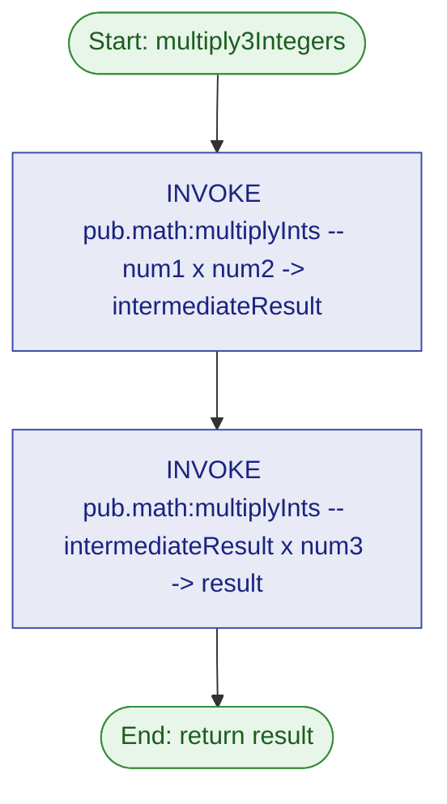

# Service Documentation: demo:multiply3Integers

## Purpose

Multiplies three integers together and returns their product as a single output value. The service accepts three integer operands represented as strings, performs the multiplication in two sequential steps — first `num1 × num2`, then the intermediate result `× num3` — and returns the final product in `result`.

---

## Service Signature

### Inputs

| Parameter | Type | Constraints | Description |
|---|---|---|---|
| `num1` | `String` | — | First integer operand (represented as a String). Must be a valid integer value in locale-neutral format (e.g. `"3"`). |
| `num2` | `String` | — | Second integer operand (represented as a String). Must be a valid integer value in locale-neutral format (e.g. `"4"`). |
| `num3` | `String` | — | Third integer operand (represented as a String). Must be a valid integer value in locale-neutral format (e.g. `"5"`). |

### Outputs

| Parameter | Type | Description |
|---|---|---|
| `result` | `String` | The product of `num1 × num2 × num3`, returned as a String. Example: inputs `3`, `4`, `5` produce `"60"`. |

---

## Flow Diagram

---

## Usage Examples

### Example 1 — Multiplication de trois entiers positifs

**Input:**
| Parameter | Value |
|---|---|
| `num1` | `"3"` |
| `num2` | `"4"` |
| `num3` | `"5"` |

**Output:**
| Parameter | Value |
|---|---|
| `result` | `"60"` |

---

### Example 2 — Multiplication avec l'élément neutre (×1)

**Input:**
| Parameter | Value |
|---|---|
| `num1` | `"7"` |
| `num2` | `"1"` |
| `num3` | `"9"` |

**Output:**
| Parameter | Value |
|---|---|
| `result` | `"63"` |

---

### Example 3 — Multiplication par zéro

**Input:**
| Parameter | Value |
|---|---|
| `num1` | `"5"` |
| `num2` | `"0"` |
| `num3` | `"8"` |

**Output:**
| Parameter | Value |
|---|---|
| `result` | `"0"` |

---

## Implementation Details

Puisque `pub.math:multiplyInts` n'accepte que deux opérandes, la multiplication à trois termes est décomposée en **deux invocations chaînées** :

| Étape | Service appelé | Entrées | Sortie |
|---|---|---|---|
| 1 | `pub.math:multiplyInts` | `num1`, `num2` | `intermediateResult` |
| 2 | `pub.math:multiplyInts` | `intermediateResult`, `num3` | `result` |

**Gestion des variables stale (BP-002) :** Après la première invocation, les variables `num1` et `num2` restent dans le pipeline. La seconde invocation les écrase explicitement en mappant `intermediateResult → num1` et `num3 → num2` dans son propre bloc `mapTarget`, évitant toute injection silencieuse de valeurs périmées.

Tous les paramètres sont déclarés en `String` de bout en bout, conformément au contrat du catalogue `pub.math:multiplyInts` (qui exige des String même pour des opérandes entiers).

---

## Error Handling

Ce service ne contient **aucun bloc TRY/CATCH**. Les cas d'erreur suivants sont délégués au comportement natif de l'Integration Server :

| Situation | Comportement |
|---|---|
| Valeur non numérique (ex. `"abc"`) | `pub.math:multiplyInts` lève une exception de service IS propagée à l'appelant |
| Dépassement de capacité (résultat > 64 bits) | `pub.math:multiplyInts` génère un data overflow |
| Paramètre manquant / null | IS lève une exception `Missing Parameter` |

---

## Related Services

| Service | Purpose |
|---|---|
| `pub.math:multiplyInts` | Multiplie deux entiers représentés en String et retourne le produit (`value`) |

---

## Notes

- Tous les paramètres d'entrée et de sortie sont de type `String` — c'est la convention du pipeline webMethods pour les services `pub.math:*`.
- Les valeurs doivent être passées au format neutre (sans séparateur de milliers, sans virgule décimale locale), par exemple `"1234"` et non `"1.234"` ou `"1,234"`.
- Le résultat ne doit pas dépasser la capacité du type `long` Java (64 bits, soit environ ±9,2 × 10¹⁸). Au-delà, un data overflow est généré.
- Le service est déclaré `stateless: true` et `cacheResults: false` — il peut être appelé en parallèle sans risque d'état partagé.
